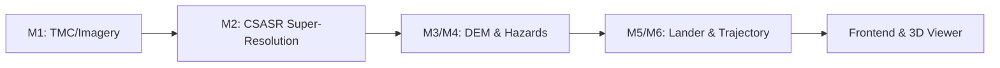
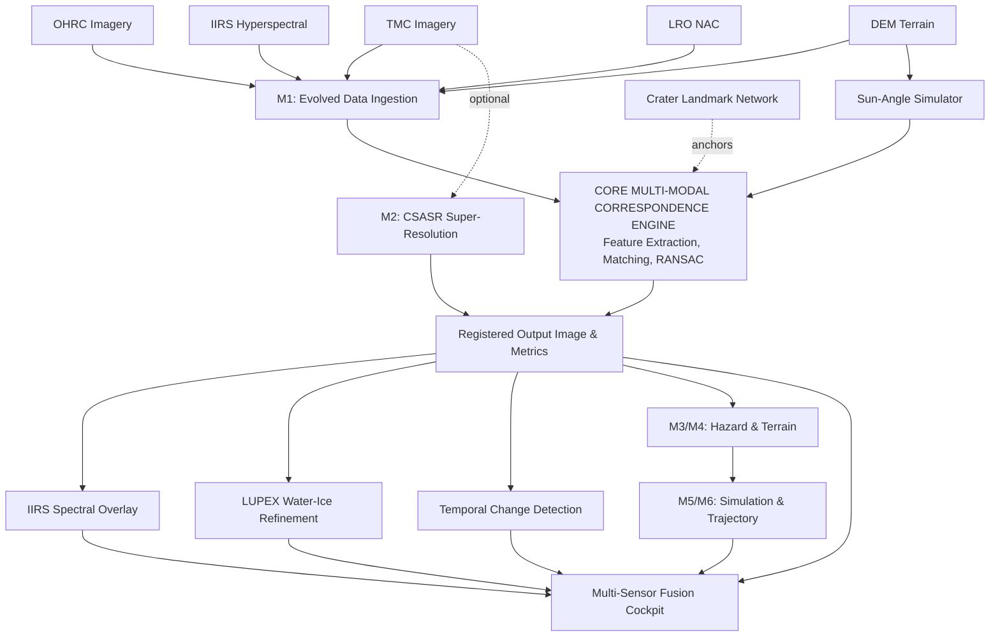

# Existing Project & Target Architecture

## 1. Current Architecture Overview

The existing repository implements a Lunar Hazard Mapper with an already validated processing pipeline. The architecture currently supports imagery ingestion, terrain mapping, super-resolution, hazard analysis, and physical simulations. 

### Current Modules
*   **M1 (Data & Geospatial):** Lunar imagery ingestion, GeoTIFF processing, preprocessing, normalization, and geospatial handling.
*   **M2 (CSASR):** Validated Stage 1 and Stage 2 CSASR lunar super-resolution pipeline producing a 32× output. Integrated with existing API and frontend for TMC upload/comparison. (Commit: `6fed60d`)
*   **M3 (DEM Terrain):** DEM-backed terrain functionality, physical elevation handling, geospatial coordinate transformations.
*   **M4 (Hazards):** Hazard mapping, including slope, roughness, and combined terrain/hazard visualization.
*   **M5 (Lander Site):** Lander and site evaluation tools.
*   **M6 (Simulation):** Trajectory and reachability simulation using a DEM-backed terrain provider and existing physical trajectory logic. (Commit: `9bd4e0a`)
*   **Frontend:** React/Vite application featuring a lunar UI, imagery workflow, hazard map visualization, 3D visualization, and simulation UI.
*   **Backend:** FastAPI backend handling the existing pipeline APIs.
*   **3D System:** Three.js / react-three-fiber infrastructure supporting lunar terrain visualization and Blender-generated assets.

---

## 2. Constraints: What Must NOT Be Changed

To ensure the integrity of the foundational Lunar Hazard Mapper while upgrading to the SIH26166 Multi-Modal Correspondence Platform, the following constraints apply:

*   **M2 CSASR Pipeline:** The model is scientifically validated. Do not retrain, replace, or redesign it.
*   **Hazard Maps:** The hazard mapping functionality in M4 is preserved as a complementary layer.
*   **3D Visualization:** The existing environment must remain but will be evolved into a digital twin viewer.
*   **M5 & M6:** The lander evaluation and trajectory systems must not be deleted. They will serve as an optional downstream application.
*   **No Code Deletion:** Existing functionality should coexist alongside the new correspondence pipeline.

---

## 3. Target SIH26166 Architecture

The evolved architecture will place the **Multi-Modal Correspondence Engine** at the center of the pipeline. Existing M1–M6 modules will act either as inputs, supporting context, or downstream workflows to this new engine.

### New Modules Required
*   **Correspondence Engine:** The core system for multimodal feature extraction, matching, RANSAC, and geometric verification between TMC, OHRC, IIRS, and LRO NAC.
*   **Counterfactual Sun Simulator:** A synthetic extension combining DEM and the 3D system to simulate varied illumination conditions to test correspondence robustness.
*   **Lunar Landmark Network:** A database of stable crater geometries acting as registration anchors.
*   **Spectral & Ice Intelligence:** Lightweight spectral analysis (from IIRS) and water-ice confidence layers overlaid on registered imagery.
*   **Multi-Sensor Fusion Cockpit:** Unified frontend interface for multimodal image analysis.
*   **Temporal Analysis:** Engine to compute change detection between aligned temporal datasets.

### Modules That Will Be Repurposed / Evolved
*   **M1:** Extended to support complex scene retrieval and spatial overlap detection across multi-modal sensor inputs.
*   **3D System:** Evolved from a simple terrain viewer into a full Multi-Sensor Lunar Observation / Digital-Twin Viewer.
*   **M3 & M4:** Repurposed to provide the physical terrain context for correspondence (DEM) and hazard layers over the newly registered output imagery.
*   **M5 & M6:** Repurposed as a downstream consumer of registered imagery to evaluate lander trajectories.

---

## 4. Old Pipeline vs. New Pipeline Data Flow

### Old Data Flow (Lunar Hazard Mapper)

### New Target Data Flow (SIH26166)

## 5. Dependency Relationships

*   **FastAPI Backend & React Frontend:** Remains the primary communication layer. The Backend will host the new `Correspondence Engine` endpoints alongside existing `M2`, `M4`, and `M6` APIs.
*   **DEM as the Truth Layer:** M3 (DEM) is a strict dependency for the `Sun Simulator`, the `3D Viewer`, and the `Hazard Maps`.
*   **Registration before Science:** The `Spectral Intelligence`, `Water-Ice Intelligence`, and `Change Detection` modules depend entirely on the sub-pixel accuracy of the `Correspondence Engine` output.
*   **Isolated Synthetic Generation:** The `Counterfactual Sun Simulator` is strictly isolated as an evaluation tool. Synthetic imagery must never feed back into real-world registered outputs.

